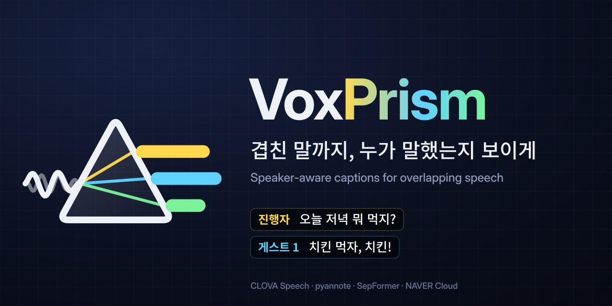

  

### 섞인 목소리를, 화자별 색으로

**VoxPrism**은 청각장애인·난청인을 위한 화자 구분 자막 서비스입니다. 영상을 올리면 말한 사람의 이름과 색이 붙은 자막을 만들고, 두 사람이 동시에 말해 묻힌 말까지 분리해서 함께 보여 줍니다.

| 저장소 | 설명 |
| --- | --- |
| [**voxprism**](https://github.com/voxprism/voxprism) | 서비스 코드 · 문서(PRD·요구사항·상세설계) · SDD 스펙 |

**만든 방식** — 네이버 클라우드 CLOVA Speech로 한국어를 받아 적고, pyannote로 화자를 나누고, SpeechBrain SepFormer로 겹친 목소리를 분리해 다시 받아 적습니다. 합성 겹침 대화 평가에서 사라지던 겹친 발화를 35개 중 28개에서 3개로 줄였습니다.

  
  
  
  
  
  

네이버 클라우드 소버린 AI 리터러시 프로젝트
